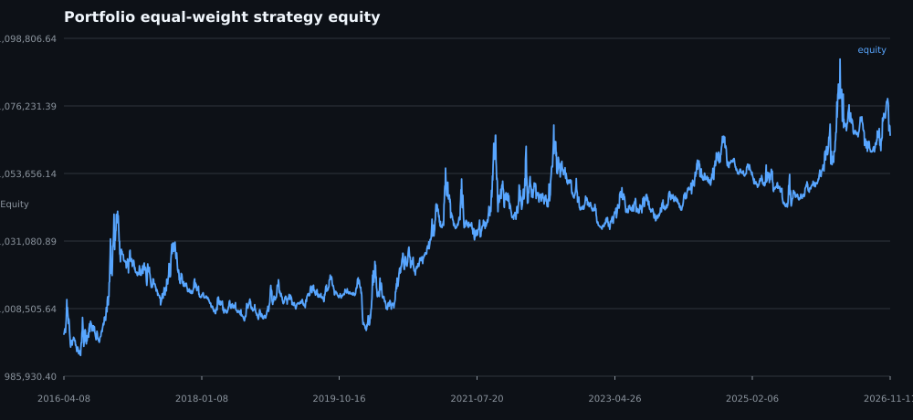
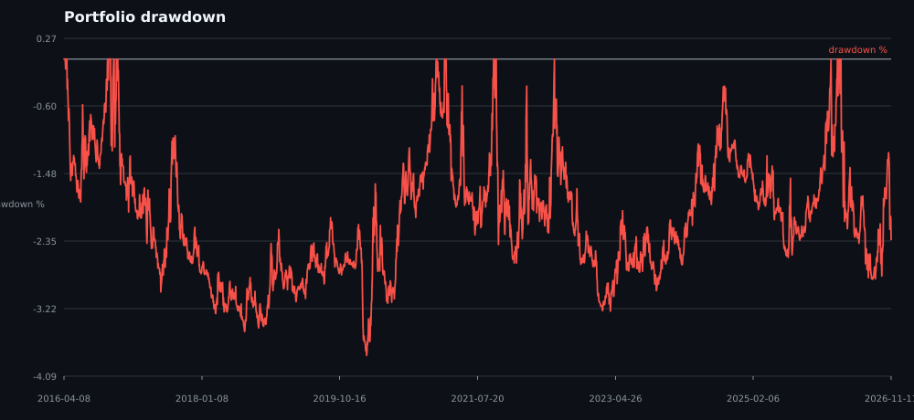
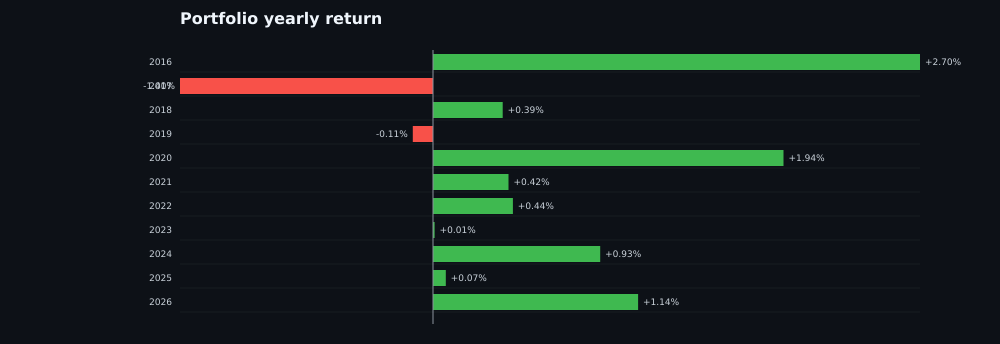
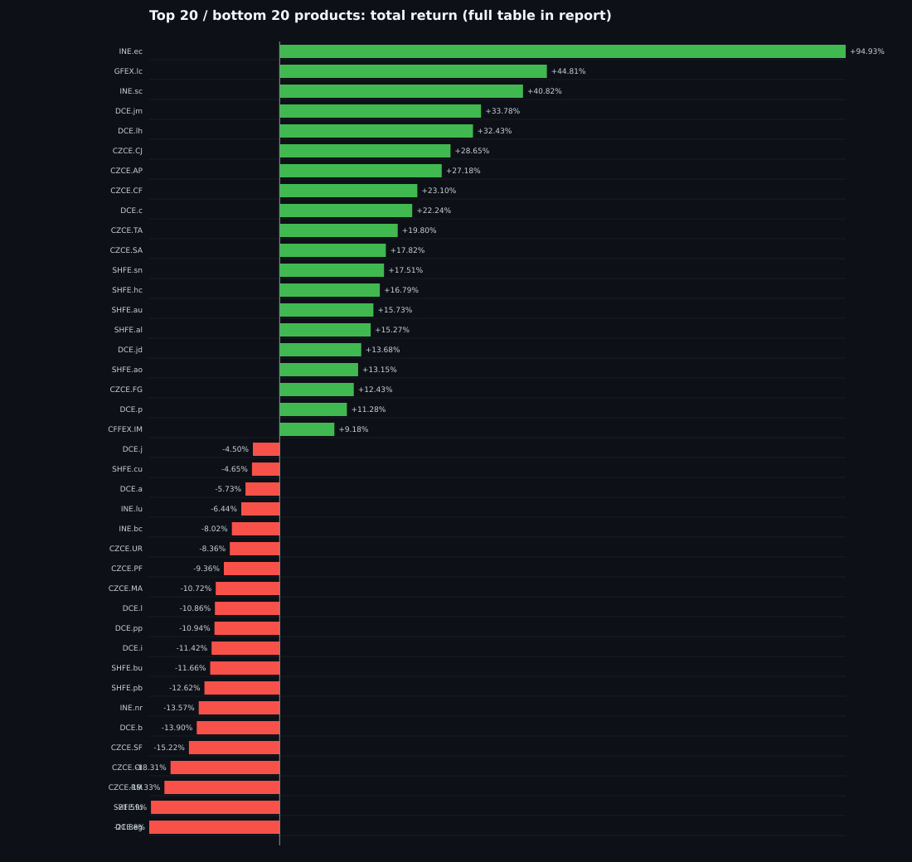
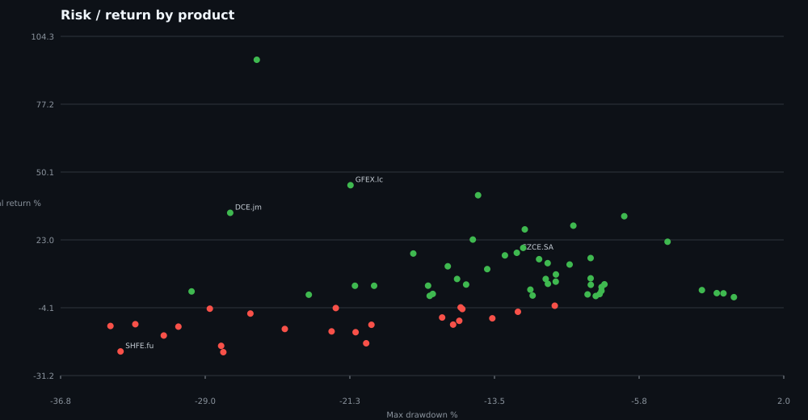
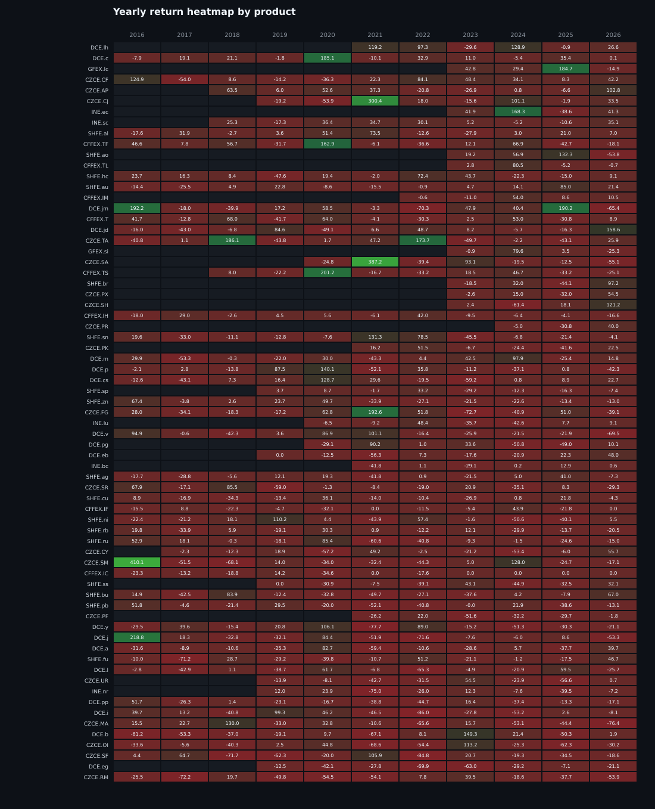
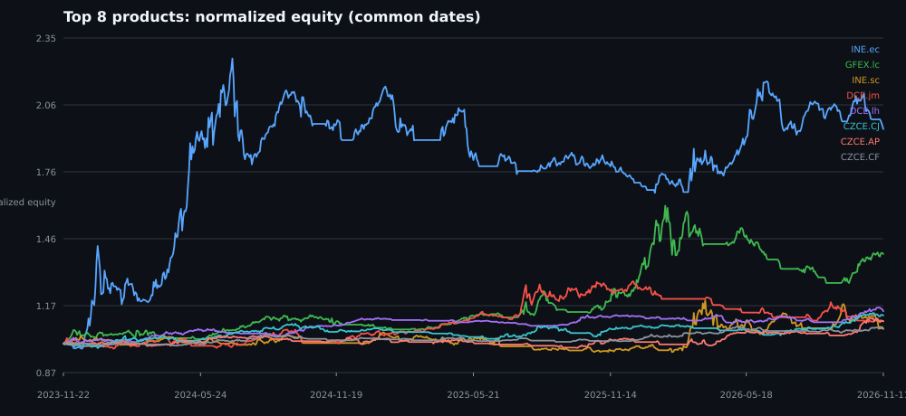
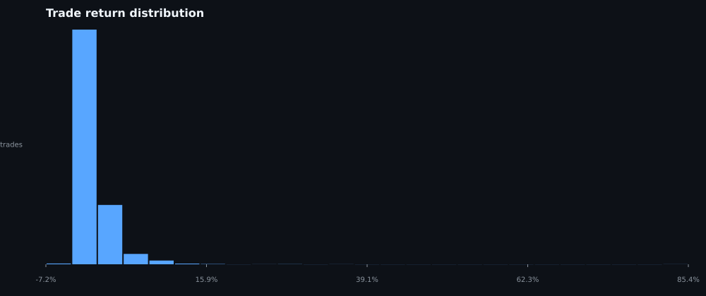

# 日线 EMA60 + Donchian22 + ATR 策略回测报告

- 生成时间：2026-11-11 19:37:57
- 数据源：Tq 官方 Backtest MD `KQ.i@<product>` 日线指数连续
- 原始数据区间：2016-01-05 至 2026-11-11（各品种上市日不同）
- 可交易信号区间：2016-04-08 至 2026-11-11
- 信号周期：日线
- 参数：EMA60、Donchian22、ATR14、2ATR 止损、30% 名义仓位、单边手续费 1.00 bp
- 执行：信号在收盘产生，下一交易日开盘成交；盘中止损；不进行同日反手；每品种最多 1 个方向仓位。

## 1. 数据与样本

- 原始品种数：89
- 纳入回测：**69** 个
- 排除：**20** 个（成交量极低、历史不足或数据为空）
- 总交易笔数：4094
- 组合期初/期末权益：1,000,000 → 1,066,445

### 1.1 排除清单

| 品种 | 原因 |
|---|---|
| KQ.i@CZCE.SO | 远端无数据：empty bars |
| KQ.i@CZCE.JR | 流动性不足：median volume=0, 零成交占比=100.0% |
| KQ.i@CZCE.LR | 流动性不足：median volume=0, 零成交占比=100.0% |
| KQ.i@CZCE.PL | 历史过短：316 < 500 bars |
| KQ.i@CZCE.PM | 流动性不足：median volume=0, 零成交占比=100.0% |
| KQ.i@CZCE.RI | 流动性不足：median volume=0, 零成交占比=100.0% |
| KQ.i@CZCE.RS | 流动性不足：median volume=38, 零成交占比=6.0% |
| KQ.i@CZCE.WH | 流动性不足：median volume=0, 零成交占比=100.0% |
| KQ.i@CZCE.ZC | 流动性不足：median volume=0, 零成交占比=100.0% |
| KQ.i@DCE.bb | 流动性不足：median volume=52, 零成交占比=8.0% |
| KQ.i@DCE.bz | 历史过短：326 < 500 bars |
| KQ.i@DCE.fb | 流动性不足：median volume=2390, 零成交占比=0.0% |
| KQ.i@DCE.lg | 历史过短：480 < 500 bars |
| KQ.i@DCE.rr | 流动性不足：median volume=4630, 零成交占比=0.0% |
| KQ.i@GFEX.pd | 历史过短：230 < 500 bars |
| KQ.i@GFEX.ps | 历史过短：452 < 500 bars |
| KQ.i@GFEX.pt | 历史过短：230 < 500 bars |
| KQ.i@SHFE.ad | 历史过短：346 < 500 bars |
| KQ.i@SHFE.op | 历史过短：280 < 500 bars |
| KQ.i@SHFE.wr | 流动性不足：median volume=52, 零成交占比=0.4% |

> 流动性规则：最近 250 根日线的成交量中位数低于阈值、零成交占比过高、历史少于最小 bar 数，或远端无数据。

## 2. 组合总体结果

| 指标 | 数值 |
|---|---:|
| 交易品种数 | 69 |
| 总交易数 | 4094 |
| 盈利品种数 | 46 |
| 品种胜率（正收益占比） | 66.67% |
| 组合总收益 | +6.65% |
| 组合 CAGR | +0.61% |
| 组合最大回撤 | -3.82% |
| 组合 Sharpe | 0.289 |
| 组合 Sortino | 0.402 |
| 组合 Calmar | 0.159 |
| 单品种平均收益 | +5.06% |
| 单品种收益中位数 | +2.62% |
| 单品种平均最大回撤 | -15.82% |
| 单品种平均 Sharpe | 0.139 |
| 全部交易 Profit Factor | 1.151 |
| 全部交易平均单笔收益 | +0.096% |
| 全部交易平均持仓天 | 35.5 |
| 累计手续费（69 个独立账户） | 250,250 |
| 年度正收益/总年份 | 9/11 |
| 最好年度 | 2016 +2.70% |
| 最差年度 | 2017 -1.40% |
| 多头/空头交易数 | 2123/1971 |
| 多头/空头胜率 | 27.3% / 28.2% |





### 2.1 年度收益

| 年份 | 组合收益 |
|---|---:|
| 2016 | +2.70% |
| 2017 | -1.40% |
| 2018 | +0.39% |
| 2019 | -0.11% |
| 2020 | +1.94% |
| 2021 | +0.42% |
| 2022 | +0.44% |
| 2023 | +0.01% |
| 2024 | +0.93% |
| 2025 | +0.07% |
| 2026 | +1.14% |



## 3. 横向对比：品种收益与风险

### 3.1 收益排名（全部纳入品种）

| 排名 | 品种 | 总收益 | CAGR | 最大回撤 | Sharpe | 交易数 | 胜率 |
|---:|---|---:|---:|---:|---:|---:|---:|
| 1 | KQ.i@INE.ec | +94.93% | +25.19% | -26.28% | 1.05 | 19 | 36.8% |
| 2 | KQ.i@GFEX.lc | +44.81% | +12.92% | -21.25% | 0.93 | 16 | 37.5% |
| 3 | KQ.i@INE.sc | +40.82% | +4.17% | -14.41% | 0.44 | 53 | 37.7% |
| 4 | KQ.i@DCE.jm | +33.78% | +2.79% | -27.71% | 0.33 | 67 | 32.8% |
| 5 | KQ.i@DCE.lh | +32.43% | +5.17% | -6.57% | 1.11 | 36 | 25.0% |
| 6 | KQ.i@CZCE.CJ | +28.65% | +3.52% | -9.30% | 0.59 | 44 | 27.3% |
| 7 | KQ.i@CZCE.AP | +27.18% | +2.83% | -11.91% | 0.51 | 55 | 36.4% |
| 8 | KQ.i@CZCE.CF | +23.10% | +1.98% | -14.69% | 0.43 | 70 | 35.7% |
| 9 | KQ.i@DCE.c | +22.24% | +1.91% | -4.25% | 0.70 | 60 | 38.3% |
| 10 | KQ.i@CZCE.TA | +19.80% | +1.72% | -11.99% | 0.29 | 71 | 26.8% |
| 11 | KQ.i@CZCE.SA | +17.82% | +2.49% | -12.33% | 0.34 | 44 | 38.6% |
| 12 | KQ.i@SHFE.sn | +17.51% | +1.53% | -17.89% | 0.25 | 68 | 22.1% |
| 13 | KQ.i@SHFE.hc | +16.79% | +1.48% | -12.97% | 0.29 | 66 | 33.3% |
| 14 | KQ.i@SHFE.au | +15.73% | +1.39% | -8.37% | 0.34 | 67 | 28.4% |
| 15 | KQ.i@SHFE.al | +15.27% | +1.35% | -11.14% | 0.32 | 71 | 36.6% |
| 16 | KQ.i@DCE.jd | +13.68% | +1.22% | -10.68% | 0.30 | 76 | 31.6% |
| 17 | KQ.i@SHFE.ao | +13.15% | +3.99% | -9.50% | 0.68 | 17 | 35.3% |
| 18 | KQ.i@CZCE.FG | +12.43% | +1.11% | -16.04% | 0.20 | 74 | 28.4% |
| 19 | KQ.i@DCE.p | +11.28% | +1.01% | -13.92% | 0.20 | 71 | 31.0% |
| 20 | KQ.i@CFFEX.IM | +9.18% | +2.20% | -10.24% | 0.36 | 23 | 43.5% |
| 21 | KQ.i@SHFE.sp | +7.61% | +0.96% | -8.37% | 0.23 | 53 | 28.3% |
| 22 | KQ.i@GFEX.si | +7.37% | +1.98% | -10.78% | 0.44 | 19 | 36.8% |
| 23 | KQ.i@DCE.m | +7.36% | +0.67% | -15.54% | 0.17 | 74 | 32.4% |
| 24 | KQ.i@DCE.cs | +6.31% | +0.58% | -10.25% | 0.20 | 70 | 28.6% |
| 25 | KQ.i@SHFE.br | +5.44% | +1.76% | -10.66% | 0.26 | 19 | 47.4% |
| 26 | KQ.i@CZCE.PX | +5.23% | +1.78% | -7.63% | 0.29 | 18 | 22.2% |
| 27 | KQ.i@CFFEX.IC | +5.13% | +0.47% | -15.05% | 0.11 | 72 | 31.9% |
| 28 | KQ.i@CFFEX.IH | +5.04% | +0.46% | -8.36% | 0.12 | 68 | 25.0% |
| 29 | KQ.i@DCE.v | +4.68% | +0.43% | -17.09% | 0.11 | 71 | 33.8% |
| 30 | KQ.i@SHFE.ru | +4.65% | +0.43% | -19.99% | 0.10 | 74 | 25.7% |
| 31 | KQ.i@CZCE.SM | +4.65% | +0.43% | -21.02% | 0.10 | 74 | 28.4% |
| 32 | KQ.i@CZCE.SH | +4.15% | +1.41% | -7.79% | 0.26 | 22 | 31.8% |
| 33 | KQ.i@SHFE.rb | +3.09% | +0.29% | -11.61% | 0.08 | 73 | 31.5% |
| 34 | KQ.i@CFFEX.TL | +2.92% | +0.88% | -2.40% | 0.54 | 19 | 31.6% |
| 35 | KQ.i@CZCE.PR | +2.62% | +1.35% | -7.79% | 0.21 | 16 | 25.0% |
| 36 | KQ.i@SHFE.ag | +2.40% | +0.22% | -29.78% | 0.07 | 82 | 18.3% |
| 37 | KQ.i@CFFEX.T | +1.71% | +0.16% | -1.61% | 0.19 | 72 | 26.4% |
| 38 | KQ.i@CFFEX.TF | +1.60% | +0.15% | -1.25% | 0.28 | 65 | 30.8% |
| 39 | KQ.i@DCE.eb | +1.39% | +0.20% | -16.84% | 0.07 | 53 | 28.3% |
| 40 | KQ.i@CZCE.SR | +1.33% | +0.12% | -7.89% | 0.06 | 74 | 25.7% |
| 41 | KQ.i@CZCE.PK | +1.19% | +0.21% | -8.54% | 0.08 | 34 | 32.4% |
| 42 | KQ.i@SHFE.ni | +1.06% | +0.10% | -23.49% | 0.05 | 68 | 29.4% |
| 43 | KQ.i@CFFEX.IF | +0.73% | +0.07% | -11.49% | 0.04 | 67 | 26.9% |
| 44 | KQ.i@SHFE.zn | +0.61% | +0.06% | -17.01% | 0.04 | 69 | 27.5% |
| 45 | KQ.i@CZCE.CY | +0.57% | +0.06% | -8.10% | 0.04 | 66 | 25.8% |
| 46 | KQ.i@CFFEX.TS | +0.12% | +0.01% | -0.69% | 0.07 | 51 | 29.4% |
| 47 | KQ.i@SHFE.ss | -3.30% | -0.49% | -10.30% | -0.08 | 47 | 25.5% |
| 48 | KQ.i@DCE.y | -3.99% | -0.38% | -15.35% | -0.06 | 73 | 32.9% |
| 49 | KQ.i@DCE.pg | -4.24% | -0.68% | -22.04% | -0.04 | 52 | 17.3% |
| 50 | KQ.i@DCE.j | -4.50% | -0.43% | -28.80% | -0.00 | 81 | 27.2% |
| 51 | KQ.i@SHFE.cu | -4.65% | -0.45% | -15.25% | -0.08 | 81 | 21.0% |
| 52 | KQ.i@DCE.a | -5.73% | -0.56% | -12.27% | -0.14 | 79 | 25.3% |
| 53 | KQ.i@INE.lu | -6.44% | -1.08% | -26.63% | -0.05 | 44 | 27.3% |
| 54 | KQ.i@INE.bc | -8.02% | -1.45% | -16.34% | -0.30 | 44 | 18.2% |
| 55 | KQ.i@CZCE.UR | -8.36% | -1.24% | -13.65% | -0.17 | 49 | 26.5% |
| 56 | KQ.i@CZCE.PF | -9.36% | -1.67% | -15.42% | -0.25 | 44 | 22.7% |
| 57 | KQ.i@CZCE.MA | -10.72% | -1.06% | -32.79% | -0.12 | 77 | 29.9% |
| 58 | KQ.i@DCE.l | -10.86% | -1.08% | -15.75% | -0.20 | 77 | 28.6% |
| 59 | KQ.i@DCE.pp | -10.94% | -1.09% | -20.13% | -0.18 | 79 | 24.1% |
| 60 | KQ.i@DCE.i | -11.42% | -1.14% | -34.13% | -0.09 | 81 | 27.2% |
| 61 | KQ.i@SHFE.bu | -11.66% | -1.16% | -30.48% | -0.12 | 78 | 25.6% |
| 62 | KQ.i@SHFE.pb | -12.62% | -1.27% | -24.78% | -0.29 | 84 | 21.4% |
| 63 | KQ.i@INE.nr | -13.57% | -2.06% | -22.27% | -0.32 | 50 | 22.0% |
| 64 | KQ.i@DCE.b | -13.90% | -1.40% | -20.98% | -0.28 | 79 | 20.3% |
| 65 | KQ.i@CZCE.SF | -15.22% | -1.55% | -31.27% | -0.17 | 76 | 18.4% |
| 66 | KQ.i@CZCE.OI | -18.31% | -1.89% | -20.41% | -0.41 | 81 | 24.7% |
| 67 | KQ.i@CZCE.RM | -19.33% | -2.01% | -28.19% | -0.36 | 89 | 19.1% |
| 68 | KQ.i@SHFE.fu | -21.59% | -2.27% | -33.59% | -0.12 | 72 | 26.4% |
| 69 | KQ.i@DCE.eg | -21.88% | -3.17% | -28.08% | -0.42 | 66 | 16.7% |



### 3.2 收益-回撤散点



### 3.3 分品种详细数据

| 品种 | 区间 | Bars | 交易 | 胜率 | 期末权益 | 总收益 | CAGR | 最大回撤 | Sharpe | Sortino | Calmar | PF | 平均持仓天 | 多/空交易 | 暴露 | 买入持有 |
|---|---|---:|---:|---:|---:|---:|---:|---:|---:|---:|---:|---:|---:|---:|---:|---:|
| KQ.i@INE.ec | 2023-08-21~2026-11-11 | 780 | 19 | 36.8% | 1,949,340 | +94.93% | +25.19% | -26.28% | 1.05 | 1.61 | 0.96 | 3.23 | 48 | 9/10 | 83.9% | +223.15% |
| KQ.i@GFEX.lc | 2023-07-24~2026-11-11 | 800 | 16 | 37.5% | 1,448,137 | +44.81% | +12.92% | -21.25% | 0.93 | 1.33 | 0.61 | 2.99 | 53 | 7/9 | 76.9% | -37.20% |
| KQ.i@INE.sc | 2018-03-27~2026-11-11 | 2093 | 53 | 37.7% | 1,408,184 | +40.82% | +4.17% | -14.41% | 0.44 | 0.63 | 0.29 | 1.93 | 43 | 29/24 | 74.6% | +21.16% |
| KQ.i@DCE.jm | 2016-01-05~2026-11-11 | 2635 | 67 | 32.8% | 1,337,844 | +33.78% | +2.79% | -27.71% | 0.33 | 0.47 | 0.10 | 1.43 | 42 | 39/28 | 73.6% | +116.23% |
| KQ.i@DCE.lh | 2021-01-11~2026-11-11 | 1413 | 36 | 25.0% | 1,324,291 | +32.43% | +5.17% | -6.57% | 1.11 | 1.66 | 0.79 | 2.82 | 42 | 18/18 | 74.9% | -61.87% |
| KQ.i@CZCE.CJ | 2019-05-06~2026-11-11 | 1826 | 44 | 27.3% | 1,286,550 | +28.65% | +3.52% | -9.30% | 0.59 | 0.90 | 0.38 | 2.09 | 42 | 20/24 | 71.4% | -37.19% |
| KQ.i@CZCE.AP | 2017-12-25~2026-11-11 | 2153 | 55 | 36.4% | 1,271,801 | +27.18% | +2.83% | -11.91% | 0.51 | 0.75 | 0.24 | 1.83 | 40 | 26/29 | 70.2% | -18.08% |
| KQ.i@CZCE.CF | 2016-01-05~2026-11-11 | 2635 | 70 | 35.7% | 1,230,966 | +23.10% | +1.98% | -14.69% | 0.43 | 0.64 | 0.13 | 1.83 | 38 | 38/32 | 69.3% | +49.04% |
| KQ.i@DCE.c | 2016-01-05~2026-11-11 | 2635 | 60 | 38.3% | 1,222,404 | +22.24% | +1.91% | -4.25% | 0.70 | 1.04 | 0.45 | 2.41 | 50 | 33/27 | 78.1% | +45.92% |
| KQ.i@CZCE.TA | 2016-01-05~2026-11-11 | 2635 | 71 | 26.8% | 1,197,986 | +19.80% | +1.72% | -11.99% | 0.29 | 0.43 | 0.14 | 1.45 | 40 | 39/32 | 74.4% | +26.14% |
| KQ.i@CZCE.SA | 2019-12-09~2026-11-11 | 1678 | 44 | 38.6% | 1,178,199 | +17.82% | +2.49% | -12.33% | 0.34 | 0.49 | 0.20 | 1.48 | 39 | 22/22 | 72.3% | -35.76% |
| KQ.i@SHFE.sn | 2016-01-05~2026-11-11 | 2635 | 68 | 22.1% | 1,175,130 | +17.51% | +1.53% | -17.89% | 0.25 | 0.37 | 0.09 | 1.33 | 34 | 37/31 | 60.6% | +227.59% |
| KQ.i@SHFE.hc | 2016-01-05~2026-11-11 | 2635 | 66 | 33.3% | 1,167,921 | +16.79% | +1.48% | -12.97% | 0.29 | 0.42 | 0.11 | 1.46 | 39 | 33/33 | 67.2% | +28.73% |
| KQ.i@SHFE.au | 2016-01-05~2026-11-11 | 2635 | 67 | 28.4% | 1,157,260 | +15.73% | +1.39% | -8.37% | 0.34 | 0.47 | 0.17 | 1.69 | 38 | 37/30 | 67.3% | +241.04% |
| KQ.i@SHFE.al | 2016-01-05~2026-11-11 | 2635 | 71 | 36.6% | 1,152,664 | +15.27% | +1.35% | -11.14% | 0.32 | 0.46 | 0.12 | 1.61 | 39 | 38/33 | 72.5% | +88.15% |
| KQ.i@DCE.jd | 2016-01-05~2026-11-11 | 2635 | 76 | 31.6% | 1,136,798 | +13.68% | +1.22% | -10.68% | 0.30 | 0.43 | 0.11 | 1.40 | 38 | 43/33 | 77.1% | -10.16% |
| KQ.i@SHFE.ao | 2023-06-20~2026-11-11 | 822 | 17 | 35.3% | 1,131,511 | +13.15% | +3.99% | -9.50% | 0.68 | 1.05 | 0.42 | 2.12 | 44 | 10/7 | 67.3% | -11.85% |
| KQ.i@CZCE.FG | 2016-01-05~2026-11-11 | 2635 | 74 | 28.4% | 1,124,328 | +12.43% | +1.11% | -16.04% | 0.20 | 0.29 | 0.07 | 1.24 | 38 | 36/38 | 72.5% | -4.53% |
| KQ.i@DCE.p | 2016-01-05~2026-11-11 | 2635 | 71 | 31.0% | 1,112,836 | +11.28% | +1.01% | -13.92% | 0.20 | 0.28 | 0.07 | 1.25 | 37 | 38/33 | 68.9% | +64.34% |
| KQ.i@CFFEX.IM | 2022-07-25~2026-11-11 | 1042 | 23 | 43.5% | 1,091,803 | +9.18% | +2.20% | -10.24% | 0.36 | 0.53 | 0.21 | 1.83 | 44 | 11/12 | 69.0% | +2.02% |
| KQ.i@SHFE.sp | 2018-11-28~2026-11-11 | 1928 | 53 | 28.3% | 1,076,141 | +7.61% | +0.96% | -8.37% | 0.23 | 0.32 | 0.11 | 1.26 | 37 | 29/24 | 70.2% | -15.29% |
| KQ.i@GFEX.si | 2022-12-23~2026-11-11 | 939 | 19 | 36.8% | 1,073,718 | +7.37% | +1.98% | -10.78% | 0.44 | 0.62 | 0.18 | 1.60 | 39 | 10/9 | 57.3% | -46.28% |
| KQ.i@DCE.m | 2016-01-05~2026-11-11 | 2635 | 74 | 32.4% | 1,073,596 | +7.36% | +0.67% | -15.54% | 0.17 | 0.25 | 0.04 | 1.22 | 37 | 39/35 | 70.2% | +28.72% |
| KQ.i@DCE.cs | 2016-01-05~2026-11-11 | 2635 | 70 | 28.6% | 1,063,076 | +6.31% | +0.58% | -10.25% | 0.20 | 0.29 | 0.06 | 1.25 | 40 | 38/32 | 73.3% | +31.42% |
| KQ.i@SHFE.br | 2023-07-31~2026-11-11 | 795 | 19 | 47.4% | 1,054,368 | +5.44% | +1.76% | -10.66% | 0.26 | 0.38 | 0.17 | 1.50 | 40 | 8/11 | 69.2% | +19.36% |
| KQ.i@CZCE.PX | 2023-09-18~2026-11-11 | 760 | 18 | 22.2% | 1,052,269 | +5.23% | +1.78% | -7.63% | 0.29 | 0.42 | 0.23 | 1.60 | 37 | 10/8 | 62.1% | -1.99% |
| KQ.i@CFFEX.IC | 2016-01-05~2026-11-11 | 2635 | 72 | 31.9% | 1,051,321 | +5.13% | +0.47% | -15.05% | 0.11 | 0.16 | 0.03 | 1.14 | 36 | 35/37 | 68.6% | +10.43% |
| KQ.i@CFFEX.IH | 2016-01-05~2026-11-11 | 2635 | 68 | 25.0% | 1,050,358 | +5.04% | +0.46% | -8.36% | 0.12 | 0.18 | 0.06 | 1.16 | 40 | 33/35 | 70.7% | +28.73% |
| KQ.i@DCE.v | 2016-01-05~2026-11-11 | 2635 | 71 | 33.8% | 1,046,845 | +4.68% | +0.43% | -17.09% | 0.11 | 0.15 | 0.03 | 1.12 | 36 | 32/39 | 67.6% | -2.26% |
| KQ.i@SHFE.ru | 2016-01-05~2026-11-11 | 2635 | 74 | 25.7% | 1,046,532 | +4.65% | +0.43% | -19.99% | 0.10 | 0.15 | 0.02 | 1.09 | 35 | 42/32 | 67.6% | +67.47% |
| KQ.i@CZCE.SM | 2016-01-05~2026-11-11 | 2635 | 74 | 28.4% | 1,046,453 | +4.65% | +0.43% | -21.02% | 0.10 | 0.14 | 0.02 | 1.11 | 35 | 38/36 | 67.4% | +10.25% |
| KQ.i@CZCE.SH | 2023-09-18~2026-11-11 | 760 | 22 | 31.8% | 1,041,478 | +4.15% | +1.41% | -7.79% | 0.26 | 0.38 | 0.18 | 1.33 | 36 | 8/14 | 75.0% | -40.71% |
| KQ.i@SHFE.rb | 2016-01-05~2026-11-11 | 2635 | 73 | 31.5% | 1,030,911 | +3.09% | +0.29% | -11.61% | 0.08 | 0.11 | 0.02 | 1.08 | 36 | 37/36 | 69.7% | +38.19% |
| KQ.i@CFFEX.TL | 2023-04-24~2026-11-11 | 860 | 19 | 31.6% | 1,029,239 | +2.92% | +0.88% | -2.40% | 0.54 | 0.75 | 0.37 | 2.07 | 46 | 12/7 | 73.5% | +19.56% |
| KQ.i@CZCE.PR | 2024-09-02~2026-11-11 | 529 | 16 | 25.0% | 1,026,176 | +2.62% | +1.35% | -7.79% | 0.21 | 0.32 | 0.17 | 1.33 | 28 | 9/7 | 63.0% | +22.46% |
| KQ.i@SHFE.ag | 2016-01-05~2026-11-11 | 2635 | 82 | 18.3% | 1,024,035 | +2.40% | +0.22% | -29.78% | 0.07 | 0.10 | 0.01 | 1.04 | 28 | 42/40 | 61.3% | +276.65% |
| KQ.i@CFFEX.T | 2016-01-05~2026-11-11 | 2635 | 72 | 26.4% | 1,017,120 | +1.71% | +0.16% | -1.61% | 0.19 | 0.28 | 0.10 | 1.34 | 39 | 41/31 | 74.4% | +10.82% |
| KQ.i@CFFEX.TF | 2016-01-05~2026-11-11 | 2635 | 65 | 30.8% | 1,016,045 | +1.60% | +0.15% | -1.25% | 0.28 | 0.41 | 0.12 | 1.54 | 42 | 35/30 | 70.8% | +5.99% |
| KQ.i@DCE.eb | 2019-09-27~2026-11-11 | 1724 | 53 | 28.3% | 1,013,929 | +1.39% | +0.20% | -16.84% | 0.07 | 0.09 | 0.01 | 1.05 | 30 | 26/27 | 62.2% | +18.66% |
| KQ.i@CZCE.SR | 2016-01-05~2026-11-11 | 2635 | 74 | 25.7% | 1,013,278 | +1.33% | +0.12% | -7.89% | 0.06 | 0.08 | 0.02 | 1.06 | 34 | 38/36 | 67.7% | -7.59% |
| KQ.i@CZCE.PK | 2021-02-02~2026-11-11 | 1397 | 34 | 32.4% | 1,011,850 | +1.19% | +0.21% | -8.54% | 0.08 | 0.11 | 0.03 | 1.11 | 41 | 17/17 | 69.2% | -24.36% |
| KQ.i@SHFE.ni | 2016-01-05~2026-11-11 | 2635 | 68 | 29.4% | 1,010,594 | +1.06% | +0.10% | -23.49% | 0.05 | 0.08 | 0.00 | 1.02 | 38 | 39/29 | 68.2% | +81.41% |
| KQ.i@CFFEX.IF | 2016-01-05~2026-11-11 | 2635 | 67 | 26.9% | 1,007,347 | +0.73% | +0.07% | -11.49% | 0.04 | 0.06 | 0.01 | 1.03 | 38 | 33/34 | 67.2% | +27.06% |
| KQ.i@SHFE.zn | 2016-01-05~2026-11-11 | 2635 | 69 | 27.5% | 1,006,118 | +0.61% | +0.06% | -17.01% | 0.04 | 0.05 | 0.00 | 1.02 | 39 | 35/34 | 69.7% | +79.52% |
| KQ.i@CZCE.CY | 2017-08-21~2026-11-11 | 2238 | 66 | 25.8% | 1,005,704 | +0.57% | +0.06% | -8.10% | 0.04 | 0.06 | 0.01 | 1.03 | 33 | 31/35 | 66.9% | -7.02% |
| KQ.i@CFFEX.TS | 2018-08-20~2026-11-11 | 1994 | 51 | 29.4% | 1,001,187 | +0.12% | +0.01% | -0.69% | 0.07 | 0.10 | 0.02 | 1.24 | 38 | 31/20 | 67.7% | +2.60% |
| KQ.i@SHFE.ss | 2019-09-26~2026-11-11 | 1725 | 47 | 25.5% | 966,959 | -3.30% | -0.49% | -10.30% | -0.08 | -0.11 | -0.05 | 0.87 | 33 | 24/23 | 64.3% | -2.08% |
| KQ.i@DCE.y | 2016-01-05~2026-11-11 | 2635 | 73 | 32.9% | 960,062 | -3.99% | -0.38% | -15.35% | -0.06 | -0.09 | -0.03 | 0.90 | 34 | 38/35 | 65.0% | +41.86% |
| KQ.i@DCE.pg | 2020-03-31~2026-11-11 | 1604 | 52 | 17.3% | 957,603 | -4.24% | -0.68% | -22.04% | -0.04 | -0.06 | -0.03 | 0.89 | 29 | 27/25 | 65.8% | +66.81% |
| KQ.i@DCE.j | 2016-01-05~2026-11-11 | 2635 | 81 | 27.2% | 955,024 | -4.50% | -0.43% | -28.80% | -0.00 | -0.00 | -0.02 | 0.95 | 33 | 46/35 | 71.9% | +136.95% |
| KQ.i@SHFE.cu | 2016-01-05~2026-11-11 | 2635 | 81 | 21.0% | 953,545 | -4.65% | -0.45% | -15.25% | -0.08 | -0.11 | -0.03 | 0.88 | 29 | 45/36 | 62.2% | +185.95% |
| KQ.i@DCE.a | 2016-01-05~2026-11-11 | 2635 | 79 | 25.3% | 942,716 | -5.73% | -0.56% | -12.27% | -0.14 | -0.19 | -0.05 | 0.84 | 31 | 40/39 | 64.6% | +58.30% |
| KQ.i@INE.lu | 2020-06-23~2026-11-11 | 1548 | 44 | 27.3% | 935,614 | -6.44% | -1.08% | -26.63% | -0.05 | -0.07 | -0.04 | 0.86 | 31 | 21/23 | 61.9% | +104.68% |
| KQ.i@INE.bc | 2020-11-20~2026-11-11 | 1448 | 44 | 18.2% | 919,816 | -8.02% | -1.45% | -16.34% | -0.30 | -0.43 | -0.09 | 0.62 | 29 | 24/20 | 61.1% | +55.33% |
| KQ.i@CZCE.UR | 2019-08-12~2026-11-11 | 1757 | 49 | 26.5% | 916,386 | -8.36% | -1.24% | -13.65% | -0.17 | -0.24 | -0.09 | 0.74 | 32 | 22/27 | 63.2% | +5.26% |
| KQ.i@CZCE.PF | 2020-10-13~2026-11-11 | 1476 | 44 | 22.7% | 906,411 | -9.36% | -1.67% | -15.42% | -0.25 | -0.36 | -0.11 | 0.56 | 31 | 25/19 | 64.5% | +12.24% |
| KQ.i@CZCE.MA | 2016-01-05~2026-11-11 | 2635 | 77 | 29.9% | 892,810 | -10.72% | -1.06% | -32.79% | -0.12 | -0.17 | -0.03 | 0.81 | 34 | 42/35 | 69.3% | +61.87% |
| KQ.i@DCE.l | 2016-01-05~2026-11-11 | 2635 | 77 | 28.6% | 891,393 | -10.86% | -1.08% | -15.75% | -0.20 | -0.29 | -0.07 | 0.69 | 32 | 39/38 | 64.5% | -1.00% |
| KQ.i@DCE.pp | 2016-01-05~2026-11-11 | 2635 | 79 | 24.1% | 890,640 | -10.94% | -1.09% | -20.13% | -0.18 | -0.26 | -0.05 | 0.74 | 31 | 39/40 | 64.6% | +30.84% |
| KQ.i@DCE.i | 2016-01-05~2026-11-11 | 2635 | 81 | 27.2% | 885,833 | -11.42% | -1.14% | -34.13% | -0.09 | -0.12 | -0.03 | 0.87 | 33 | 41/40 | 70.8% | +78.77% |
| KQ.i@SHFE.bu | 2016-01-05~2026-11-11 | 2635 | 78 | 25.6% | 883,361 | -11.66% | -1.16% | -30.48% | -0.12 | -0.16 | -0.04 | 0.80 | 35 | 38/40 | 71.3% | +142.74% |
| KQ.i@SHFE.pb | 2016-01-05~2026-11-11 | 2635 | 84 | 21.4% | 873,805 | -12.62% | -1.27% | -24.78% | -0.29 | -0.41 | -0.05 | 0.70 | 29 | 41/43 | 64.8% | +20.05% |
| KQ.i@INE.nr | 2019-08-13~2026-11-11 | 1756 | 50 | 22.0% | 864,303 | -13.57% | -2.06% | -22.27% | -0.32 | -0.46 | -0.09 | 0.58 | 32 | 26/24 | 62.5% | +58.04% |
| KQ.i@DCE.b | 2016-01-06~2026-11-11 | 2634 | 79 | 20.3% | 860,966 | -13.90% | -1.40% | -20.98% | -0.28 | -0.38 | -0.07 | 0.66 | 30 | 38/41 | 61.9% | +17.76% |
| KQ.i@CZCE.SF | 2016-01-05~2026-11-11 | 2635 | 76 | 18.4% | 847,794 | -15.22% | -1.55% | -31.27% | -0.17 | -0.24 | -0.05 | 0.69 | 31 | 38/38 | 63.3% | +28.18% |
| KQ.i@CZCE.OI | 2016-01-05~2026-11-11 | 2635 | 81 | 24.7% | 816,941 | -18.31% | -1.89% | -20.41% | -0.41 | -0.57 | -0.09 | 0.60 | 32 | 42/39 | 67.8% | +64.98% |
| KQ.i@CZCE.RM | 2016-01-05~2026-11-11 | 2635 | 89 | 19.1% | 806,652 | -19.33% | -2.01% | -28.19% | -0.36 | -0.51 | -0.07 | 0.65 | 27 | 47/42 | 64.1% | +14.99% |
| KQ.i@SHFE.fu | 2016-01-05~2026-11-11 | 2635 | 72 | 26.4% | 784,113 | -21.59% | -2.27% | -33.59% | -0.12 | -0.17 | -0.07 | 0.71 | 33 | 36/36 | 62.1% | +68.66% |
| KQ.i@DCE.eg | 2018-12-11~2026-11-11 | 1919 | 66 | 16.7% | 781,219 | -21.88% | -3.17% | -28.08% | -0.42 | -0.59 | -0.11 | 0.49 | 27 | 33/33 | 63.5% | -4.54% |

### 3.4 横截面分布（69 个品种）

| 指标 | Q1 | 中位数 | Q3 |
|---|---:|---:|---:|
| 总收益 | -6.08% | +2.62% | +12.79% |
| 最大回撤 | -21.13% | -14.69% | -9.87% |





## 4. 纵向对比：前后半段

将回测期按时间分为前半段和后半段，观察策略稳定性：

| 区间 | 组合收益 | CAGR | 最大回撤 | Sharpe | 正收益品种占比 |
|---|---:|---:|---:|---:|---:|
| 前半段 | +3.94% | +0.68% | -3.82% | 0.32 | 55.9% |
| 后半段 | +2.61% | +0.53% | -3.25% | 0.25 | 47.8% |

| 品种 | 前半段收益 | 后半段收益 | 变化 |
|---|---:|---:|---:|
| KQ.i@INE.ec | +0.00% | +94.93% | +94.93% |
| KQ.i@GFEX.lc | +0.00% | +44.81% | +44.81% |
| KQ.i@SHFE.fu | -30.88% | +13.44% | +44.32% |
| KQ.i@SHFE.ag | -14.14% | +19.27% | +33.41% |
| KQ.i@CFFEX.IC | -12.38% | +19.99% | +32.38% |
| KQ.i@SHFE.au | -7.13% | +24.61% | +31.74% |
| KQ.i@DCE.b | -20.00% | +7.62% | +27.62% |
| KQ.i@CZCE.RM | -18.43% | -1.11% | +17.32% |
| KQ.i@CZCE.CF | +3.59% | +18.83% | +15.23% |
| KQ.i@DCE.jd | -0.65% | +14.43% | +15.08% |
| KQ.i@DCE.m | -3.05% | +10.74% | +13.79% |
| KQ.i@SHFE.ao | +0.00% | +13.15% | +13.15% |
| KQ.i@DCE.eb | -5.51% | +7.31% | +12.82% |
| KQ.i@DCE.lh | +9.74% | +20.68% | +10.94% |
| KQ.i@CFFEX.IF | -4.45% | +5.42% | +9.87% |
| KQ.i@CFFEX.IM | +0.00% | +9.18% | +9.18% |
| KQ.i@SHFE.bu | -9.88% | -1.98% | +7.90% |
| KQ.i@GFEX.si | +0.00% | +7.37% | +7.37% |
| KQ.i@SHFE.br | +0.00% | +5.44% | +5.44% |
| KQ.i@CZCE.PX | +0.00% | +5.23% | +5.23% |

## 5. 多空拆解

> 多空 PnL 是 69 个品种各自独立 100 万账户的合计，不是组合账户的现金；组合收益见第 2 节。

| 方向 | 交易数 | 胜率 | 平均单笔收益 | 总 PnL |
|---|---:|---:|---:|---:|
| 多 | 2123 | 27.3% | +0.234% | 4,514,294 |
| 空 | 1971 | 28.2% | -0.052% | -899,837 |


## 6. 交易分布与风险



### 6.1 最大回撤前 10 品种

| 品种 | 最大回撤 | 总收益 | Sharpe |
|---|---:|---:|---:|
| KQ.i@DCE.i | -34.13% | -11.42% | -0.09 |
| KQ.i@SHFE.fu | -33.59% | -21.59% | -0.12 |
| KQ.i@CZCE.MA | -32.79% | -10.72% | -0.12 |
| KQ.i@CZCE.SF | -31.27% | -15.22% | -0.17 |
| KQ.i@SHFE.bu | -30.48% | -11.66% | -0.12 |
| KQ.i@SHFE.ag | -29.78% | +2.40% | 0.07 |
| KQ.i@DCE.j | -28.80% | -4.50% | -0.00 |
| KQ.i@CZCE.RM | -28.19% | -19.33% | -0.36 |
| KQ.i@DCE.eg | -28.08% | -21.88% | -0.42 |
| KQ.i@DCE.jm | -27.71% | +33.78% | 0.33 |

## 7. 结论与边界

1. 本报告使用 Tq 官方 Backtest MD 日线指数连续，覆盖 2016-01 至 2026-11，约 2,635 根日线；
2. 回测信号和成交严格按“收盘产生信号、下一交易日开盘成交”，止损在盘中触发；
3. 组合曲线是各品种策略日收益的等权平均，不是统一资金账户的逐笔撮合结果；
4. 使用当前品种池和当前流动性过滤，存在幸存者偏差；
5. 手续费按名义金额 1 bp 近似，未模拟滑点、涨跌停、保证金和合约乘数差异；
6. 指数连续没有换月跳空，适合研究信号，但不能直接当作可交易主连价格；
7. 单品种交易次数有限时，胜率/PF 的统计显著性有限，需结合多品种和分年度结果看。

### 7.1 机器可读文件

```text
artifacts/daily_backtest/results.csv
artifacts/daily_backtest/results.json
artifacts/daily_backtest/trades.csv
artifacts/daily_backtest/yearly_returns.csv
```

## 8. 复现

```bash
python3 scripts/fetch_tq_daily.py --output-dir artifacts/tq_daily
python3 scripts/backtest_daily.py \
  --data-dir artifacts/tq_daily \
  --report docs/DAILY_STRATEGY_BACKTEST.md \
  --charts-dir docs/backtest_charts \
  --output-dir artifacts/daily_backtest
```
