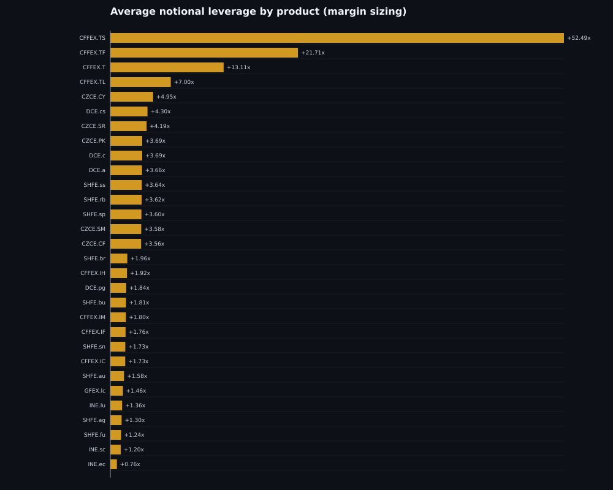

# 日线 EMA60 + Donchian22 + ATR 策略回测报告

- 生成时间：2026-11-11 20:01:13
- 数据源：Tq 官方 Backtest MD `KQ.i@<product>` 日线指数连续
- 原始数据区间：2016-01-05 至 2026-11-11（各品种上市日不同）
- 可交易信号区间：2016-04-08 至 2026-11-11
- 信号周期：日线
- 参数：EMA60、Donchian22、ATR14、2ATR 止损、30% 保证金仓位、整数手
- 执行：信号在收盘产生，下一交易日开盘成交；盘中止损；不进行同日反手；每品种最多 1 个方向仓位。
- 杠杆：保证金模式按 `lots = floor(权益 × 30% / (价格 × 合约乘数 × 保证金率))` 计算；保证金率来自当前合约规格快照。

## 1. 数据与样本

- 原始品种数：89
- 纳入回测：**69** 个
- 排除：**20** 个（成交量极低、历史不足或数据为空）
- 总交易笔数：4028
- 组合期初/期末权益：1,000,000 → 1,831,593

### 1.1 排除清单

| 品种 | 原因 |
|---|---|
| KQ.i@CZCE.SO | 远端无数据：empty bars |
| KQ.i@CZCE.JR | 流动性不足：median volume=0, 零成交占比=100.0% |
| KQ.i@CZCE.LR | 流动性不足：median volume=0, 零成交占比=100.0% |
| KQ.i@CZCE.PL | 历史过短：316 < 500 bars |
| KQ.i@CZCE.PM | 流动性不足：median volume=0, 零成交占比=100.0% |
| KQ.i@CZCE.RI | 流动性不足：median volume=0, 零成交占比=100.0% |
| KQ.i@CZCE.RS | 流动性不足：median volume=38, 零成交占比=6.0% |
| KQ.i@CZCE.WH | 流动性不足：median volume=0, 零成交占比=100.0% |
| KQ.i@CZCE.ZC | 流动性不足：median volume=0, 零成交占比=100.0% |
| KQ.i@DCE.bb | 流动性不足：median volume=52, 零成交占比=8.0% |
| KQ.i@DCE.bz | 历史过短：326 < 500 bars |
| KQ.i@DCE.fb | 流动性不足：median volume=2390, 零成交占比=0.0% |
| KQ.i@DCE.lg | 历史过短：480 < 500 bars |
| KQ.i@DCE.rr | 流动性不足：median volume=4630, 零成交占比=0.0% |
| KQ.i@GFEX.pd | 历史过短：230 < 500 bars |
| KQ.i@GFEX.ps | 历史过短：452 < 500 bars |
| KQ.i@GFEX.pt | 历史过短：230 < 500 bars |
| KQ.i@SHFE.ad | 历史过短：346 < 500 bars |
| KQ.i@SHFE.op | 历史过短：280 < 500 bars |
| KQ.i@SHFE.wr | 流动性不足：median volume=52, 零成交占比=0.4% |

> 流动性规则：最近 250 根日线的成交量中位数低于阈值、零成交占比过高、历史少于最小 bar 数，或远端无数据。

### 1.2 合约规格快照

| 品种 | 合约乘数 | 保证金率估计 | 每手手续费 |
|---|---:|---:|---:|
| KQ.i@CFFEX.IC | 200 | 11.56% | 29.33 |
| KQ.i@CFFEX.IF | 300 | 11.87% | 27.45 |
| KQ.i@CFFEX.IH | 300 | 11.96% | 18.81 |
| KQ.i@CFFEX.IM | 200 | 11.48% | 28.93 |
| KQ.i@CFFEX.T | 10000 | 2.00% | 3.00 |
| KQ.i@CFFEX.TF | 10000 | 1.20% | 3.00 |
| KQ.i@CFFEX.TL | 10000 | 3.50% | 3.00 |
| KQ.i@CFFEX.TS | 20000 | 0.50% | 3.00 |
| KQ.i@CZCE.AP | 10 | 8.91% | 5.00 |
| KQ.i@CZCE.CF | 5 | 6.95% | 4.30 |
| KQ.i@CZCE.CJ | 5 | 7.86% | 3.00 |
| KQ.i@CZCE.CY | 5 | 5.00% | 1.00 |
| KQ.i@CZCE.FG | 20 | 8.61% | 2.00 |
| KQ.i@CZCE.MA | 10 | 8.18% | 3.55 |
| KQ.i@CZCE.OI | 10 | 7.33% | 2.00 |
| KQ.i@CZCE.PF | 5 | 7.82% | 2.00 |
| KQ.i@CZCE.PK | 5 | 7.04% | 2.00 |
| KQ.i@CZCE.PR | 15 | 8.05% | 6.48 |
| KQ.i@CZCE.PX | 5 | 8.21% | 4.87 |
| KQ.i@CZCE.RM | 10 | 6.95% | 1.50 |
| KQ.i@CZCE.SA | 20 | 7.81% | 1.93 |
| KQ.i@CZCE.SF | 5 | 7.08% | 2.00 |
| KQ.i@CZCE.SH | 30 | 7.38% | 4.43 |
| KQ.i@CZCE.SM | 5 | 6.98% | 2.00 |
| KQ.i@CZCE.SR | 10 | 6.04% | 2.00 |
| KQ.i@CZCE.TA | 5 | 7.88% | 3.00 |
| KQ.i@CZCE.UR | 20 | 7.89% | 3.47 |
| KQ.i@DCE.a | 10 | 7.04% | 2.00 |
| KQ.i@DCE.b | 10 | 7.30% | 1.00 |
| KQ.i@DCE.c | 10 | 7.04% | 1.20 |
| KQ.i@DCE.cs | 10 | 6.01% | 1.50 |
| KQ.i@DCE.eb | 5 | 8.38% | 1.00 |
| KQ.i@DCE.eg | 10 | 7.65% | 3.00 |
| KQ.i@DCE.i | 100 | 10.95% | 6.76 |
| KQ.i@DCE.j | 100 | 11.57% | 26.29 |
| KQ.i@DCE.jd | 10 | 7.71% | 5.30 |
| KQ.i@DCE.jm | 60 | 12.07% | 8.41 |
| KQ.i@DCE.l | 5 | 8.12% | 1.00 |
| KQ.i@DCE.lh | 16 | 7.40% | 30.53 |
| KQ.i@DCE.m | 10 | 7.40% | 1.50 |
| KQ.i@DCE.p | 10 | 8.21% | 2.50 |
| KQ.i@DCE.pg | 20 | 14.44% | 6.00 |
| KQ.i@DCE.pp | 5 | 8.19% | 1.00 |
| KQ.i@DCE.v | 5 | 7.40% | 1.00 |
| KQ.i@DCE.y | 10 | 7.35% | 2.50 |
| KQ.i@GFEX.lc | 1 | 15.29% | 14.48 |
| KQ.i@GFEX.si | 5 | 10.07% | 4.30 |
| KQ.i@INE.bc | 5 | 11.24% | 4.81 |
| KQ.i@INE.ec | 50 | 36.19% | 77.56 |
| KQ.i@INE.lu | 10 | 20.35% | 0.61 |
| KQ.i@INE.nr | 10 | 8.86% | 3.25 |
| KQ.i@INE.sc | 1000 | 20.30% | 20.00 |
| KQ.i@SHFE.ag | 15 | 20.29% | 8.82 |
| KQ.i@SHFE.al | 5 | 11.53% | 3.00 |
| KQ.i@SHFE.ao | 20 | 10.84% | 5.26 |
| KQ.i@SHFE.au | 1000 | 15.33% | 20.00 |
| KQ.i@SHFE.br | 5 | 13.26% | 1.71 |
| KQ.i@SHFE.bu | 10 | 14.84% | 2.64 |
| KQ.i@SHFE.cu | 5 | 11.29% | 26.90 |
| KQ.i@SHFE.fu | 10 | 21.59% | 0.53 |
| KQ.i@SHFE.hc | 10 | 6.93% | 3.16 |
| KQ.i@SHFE.ni | 1 | 11.36% | 3.00 |
| KQ.i@SHFE.pb | 5 | 11.16% | 3.22 |
| KQ.i@SHFE.rb | 10 | 6.94% | 0.30 |
| KQ.i@SHFE.ru | 10 | 8.87% | 3.00 |
| KQ.i@SHFE.sn | 1 | 14.53% | 3.00 |
| KQ.i@SHFE.sp | 10 | 6.86% | 0.92 |
| KQ.i@SHFE.ss | 5 | 6.79% | 2.00 |
| KQ.i@SHFE.zn | 5 | 11.09% | 3.00 |

| 指标 | 数值 |
|---|---:|
| 交易品种数 | 69 |
| 总交易数 | 4028 |
| 盈利品种数 | 26 |
| 品种胜率（正收益占比） | 37.68% |
| 组合总收益 | +83.27% |
| 组合 CAGR | +5.89% |
| 组合最大回撤 | -24.22% |
| 组合 Sharpe | 0.421 |
| 组合 Sortino | 0.606 |
| 组合 Calmar | 0.243 |
| 单品种平均收益 | +19.30% |
| 单品种收益中位数 | -38.80% |
| 单品种平均最大回撤 | -77.47% |
| 单品种平均 Sharpe | 0.184 |
| 单品种平均名义杠杆 | 3.96x |
| 单品种最大名义杠杆 | 65.28x |
| 单品种平均保证金占用 | 24.84% |
| 因一手保证金超过预算跳过的信号 | 322 |
| 保证金强平次数 | 0 |
| 全部交易 Profit Factor | 1.054 |
| 全部交易平均单笔收益 | +0.802% |
| 全部交易平均持仓天 | 35.3 |
| 累计手续费（69 个独立账户） | 1,631,645 |
| 年度正收益/总年份 | 8/11 |
| 最好年度 | 2016 +31.32% |
| 最差年度 | 2017 -7.46% |
| 多头/空头交易数 | 2088/1940 |
| 多头/空头胜率 | 27.2% / 28.0% |


### 2.1 杠杆模式对照

同一策略、同一品种池，分别按 **30% 保证金** 和 **30% 名义（无杠杆）** 计算：

| 模型 | 总收益 | CAGR | 最大回撤 | Sharpe |
|---|---:|---:|---:|---:|
| 30% 保证金（主模型） | +83.27% | +5.89% | -24.22% | 0.42 |
| 30% 名义（无杠杆对照） | +5.38% | +0.50% | -4.00% | 0.25 |

主模型：`margin`。保证金模式每品种只使用 30% 权益作为初始保证金，余下通过合约乘数/保证金率形成杠杆；名义模式每品种只持有 30% 名义价值，不使用杠杆。

### 2.2 年度收益

| 年份 | 组合收益 |
|---|---:|
| 2016 | +31.32% |
| 2017 | -7.46% |
| 2018 | +4.86% |
| 2019 | -2.89% |
| 2020 | +25.97% |
| 2021 | +6.59% |
| 2022 | +0.66% |
| 2023 | +2.95% |
| 2024 | +4.60% |
| 2025 | -4.80% |
| 2026 | +6.87% |


## 3. 横向对比：品种收益与风险

### 3.1 收益排名（全部纳入品种）

> 总收益是各品种从自己的上市日开始累计，新品种的样本期更短；横向比较请同时看 CAGR、最大回撤、Sharpe 和起止日期。

| 排名 | 品种 | 总收益 | CAGR | 最大回撤 | Sharpe | 交易数 | 胜率 |
|---:|---|---:|---:|---:|---:|---:|---:|
| 1 | KQ.i@DCE.lh | +775.02% | +47.54% | -55.94% | 1.08 | 36 | 25.0% |
| 2 | KQ.i@DCE.c | +532.72% | +19.02% | -43.94% | 0.71 | 60 | 38.3% |
| 3 | KQ.i@GFEX.lc | +347.32% | +63.50% | -69.79% | 1.14 | 16 | 37.5% |
| 4 | KQ.i@CZCE.CF | +323.68% | +14.60% | -88.11% | 0.53 | 70 | 35.7% |
| 5 | KQ.i@CZCE.AP | +301.30% | +17.48% | -70.36% | 0.58 | 55 | 36.4% |
| 6 | KQ.i@CZCE.CJ | +291.07% | +20.59% | -72.19% | 0.62 | 44 | 27.3% |
| 7 | KQ.i@INE.ec | +230.52% | +49.55% | -48.96% | 1.08 | 19 | 36.8% |
| 8 | KQ.i@INE.sc | +198.39% | +13.94% | -47.56% | 0.54 | 53 | 37.7% |
| 9 | KQ.i@SHFE.al | +142.06% | +8.70% | -62.98% | 0.42 | 71 | 36.6% |
| 10 | KQ.i@CFFEX.TF | +132.80% | +8.30% | -58.97% | 0.41 | 65 | 32.3% |
| 11 | KQ.i@SHFE.ao | +100.76% | +24.71% | -59.98% | 0.72 | 17 | 35.3% |
| 12 | KQ.i@CFFEX.TL | +74.80% | +18.45% | -45.60% | 0.65 | 19 | 31.6% |
| 13 | KQ.i@SHFE.hc | +70.63% | +5.17% | -86.04% | 0.41 | 66 | 33.3% |
| 14 | KQ.i@SHFE.au | +68.80% | +5.07% | -40.42% | 0.35 | 67 | 28.4% |
| 15 | KQ.i@CFFEX.IM | +63.31% | +12.90% | -51.34% | 0.51 | 23 | 43.5% |
| 16 | KQ.i@DCE.jm | +60.37% | +4.56% | -88.79% | 0.39 | 67 | 32.8% |
| 17 | KQ.i@CFFEX.T | +56.65% | +4.33% | -51.40% | 0.30 | 72 | 26.4% |
| 18 | KQ.i@DCE.jd | +46.77% | +3.69% | -79.98% | 0.33 | 76 | 31.6% |
| 19 | KQ.i@CZCE.TA | +39.09% | +3.16% | -81.11% | 0.37 | 71 | 26.8% |
| 20 | KQ.i@GFEX.si | +37.55% | +9.19% | -67.21% | 0.43 | 19 | 36.8% |
| 21 | KQ.i@CZCE.SA | +35.52% | +4.66% | -80.33% | 0.49 | 44 | 38.6% |
| 22 | KQ.i@CFFEX.TS | +22.44% | +2.57% | -60.68% | 0.25 | 51 | 29.4% |
| 23 | KQ.i@SHFE.br | +18.66% | +5.81% | -55.32% | 0.37 | 19 | 47.4% |
| 24 | KQ.i@CZCE.PX | +17.62% | +5.77% | -53.84% | 0.40 | 18 | 22.2% |
| 25 | KQ.i@CZCE.SH | +3.14% | +1.07% | -70.08% | 0.37 | 22 | 31.8% |
| 26 | KQ.i@CFFEX.IH | +2.71% | +0.25% | -44.83% | 0.16 | 68 | 25.0% |
| 27 | KQ.i@CZCE.PR | -7.97% | -4.21% | -52.32% | 0.26 | 16 | 25.0% |
| 28 | KQ.i@SHFE.sn | -9.38% | -0.93% | -75.95% | 0.16 | 68 | 22.1% |
| 29 | KQ.i@CZCE.PK | -11.13% | -2.12% | -70.61% | 0.17 | 34 | 32.4% |
| 30 | KQ.i@DCE.m | -12.29% | -1.23% | -89.93% | 0.23 | 74 | 32.4% |
| 31 | KQ.i@DCE.p | -17.25% | -1.77% | -84.92% | 0.27 | 71 | 31.0% |
| 32 | KQ.i@DCE.cs | -18.45% | -1.91% | -83.44% | 0.19 | 70 | 28.6% |
| 33 | KQ.i@SHFE.sp | -28.83% | -4.33% | -73.70% | 0.21 | 53 | 28.3% |
| 34 | KQ.i@SHFE.zn | -32.54% | -3.65% | -82.18% | 0.11 | 69 | 27.5% |
| 35 | KQ.i@CZCE.FG | -38.80% | -4.53% | -88.28% | 0.24 | 74 | 28.4% |
| 36 | KQ.i@INE.lu | -45.36% | -9.37% | -75.87% | -0.02 | 44 | 27.3% |
| 37 | KQ.i@DCE.v | -49.50% | -6.24% | -91.94% | 0.20 | 71 | 33.8% |
| 38 | KQ.i@DCE.pg | -49.66% | -10.23% | -81.36% | 0.01 | 52 | 17.3% |
| 39 | KQ.i@DCE.eb | -51.65% | -10.04% | -87.65% | 0.19 | 53 | 28.3% |
| 40 | KQ.i@INE.bc | -52.53% | -12.22% | -74.43% | -0.28 | 44 | 18.2% |
| 41 | KQ.i@SHFE.ag | -53.21% | -6.92% | -79.38% | -0.08 | 82 | 18.3% |
| 42 | KQ.i@CZCE.SR | -53.45% | -6.96% | -83.79% | 0.04 | 74 | 25.7% |
| 43 | KQ.i@SHFE.cu | -53.68% | -7.01% | -77.81% | -0.08 | 81 | 21.0% |
| 44 | KQ.i@CFFEX.IF | -56.37% | -7.53% | -61.80% | -0.24 | 40 | 27.5% |
| 45 | KQ.i@SHFE.ni | -57.00% | -7.66% | -87.35% | 0.13 | 68 | 29.4% |
| 46 | KQ.i@SHFE.rb | -57.80% | -7.82% | -81.49% | 0.24 | 73 | 31.5% |
| 47 | KQ.i@SHFE.ru | -63.60% | -9.10% | -91.49% | 0.11 | 74 | 25.7% |
| 48 | KQ.i@CZCE.CY | -65.95% | -11.32% | -87.93% | 0.13 | 66 | 27.3% |
| 49 | KQ.i@CZCE.SM | -66.63% | -9.84% | -97.66% | 0.22 | 74 | 28.4% |
| 50 | KQ.i@CFFEX.IC | -66.77% | -9.87% | -67.98% | -0.37 | 33 | 18.2% |
| 51 | KQ.i@SHFE.ss | -72.63% | -17.18% | -85.74% | -0.03 | 47 | 25.5% |
| 52 | KQ.i@SHFE.bu | -73.77% | -11.86% | -92.00% | -0.07 | 78 | 25.6% |
| 53 | KQ.i@SHFE.pb | -78.24% | -13.41% | -90.35% | -0.31 | 84 | 21.4% |
| 54 | KQ.i@CZCE.PF | -79.59% | -23.82% | -87.37% | -0.11 | 44 | 22.7% |
| 55 | KQ.i@DCE.y | -80.23% | -14.18% | -93.25% | -0.05 | 73 | 32.9% |
| 56 | KQ.i@DCE.j | -80.96% | -14.49% | -96.21% | 0.07 | 81 | 25.9% |
| 57 | KQ.i@DCE.a | -81.90% | -14.90% | -89.43% | -0.15 | 79 | 25.3% |
| 58 | KQ.i@SHFE.fu | -81.92% | -14.91% | -88.90% | -0.09 | 72 | 26.4% |
| 59 | KQ.i@DCE.l | -83.95% | -15.86% | -90.11% | -0.10 | 77 | 28.6% |
| 60 | KQ.i@CZCE.UR | -84.04% | -23.08% | -89.19% | -0.05 | 49 | 26.5% |
| 61 | KQ.i@INE.nr | -85.03% | -23.79% | -93.96% | -0.20 | 50 | 22.0% |
| 62 | KQ.i@DCE.pp | -87.15% | -17.60% | -94.16% | -0.10 | 79 | 24.1% |
| 63 | KQ.i@DCE.i | -93.49% | -22.73% | -98.42% | -0.08 | 81 | 27.2% |
| 64 | KQ.i@CZCE.MA | -93.64% | -22.90% | -98.99% | -0.02 | 77 | 29.9% |
| 65 | KQ.i@DCE.b | -94.49% | -23.94% | -97.18% | -0.24 | 79 | 20.3% |
| 66 | KQ.i@CZCE.OI | -96.67% | -27.46% | -97.51% | -0.41 | 81 | 24.7% |
| 67 | KQ.i@CZCE.SF | -97.62% | -29.73% | -99.37% | -0.13 | 76 | 18.4% |
| 68 | KQ.i@DCE.eg | -97.89% | -39.56% | -98.62% | -0.43 | 66 | 16.7% |
| 69 | KQ.i@CZCE.RM | -99.08% | -35.79% | -99.67% | -0.46 | 89 | 19.1% |


### 3.2 收益-回撤散点


### 3.2.1 杠杆分布



### 3.3 分品种详细数据

| 品种 | 区间 | Bars | 交易 | 胜率 | 期末权益 | 总收益 | CAGR | 最大回撤 | Sharpe | 杠杆均值 | 保证金占用 | 平均手数 | 跳过信号 | 多/空交易 | 买入持有 |
|---|---|---:|---:|---:|---:|---:|---:|---:|---:|---:|---:|---:|---:|---:|---:|
| KQ.i@DCE.lh | 2021-01-11~2026-11-11 | 1413 | 36 | 25.0% | 8,750,172 | +775.02% | +47.54% | -55.94% | 1.08 | 2.96x | 21.9% | 71.5 | 0 | 18/18 | -61.87% |
| KQ.i@DCE.c | 2016-01-05~2026-11-11 | 2635 | 60 | 38.3% | 6,327,169 | +532.72% | +19.02% | -43.94% | 0.71 | 3.69x | 25.9% | 595.2 | 0 | 33/27 | +45.92% |
| KQ.i@GFEX.lc | 2023-07-24~2026-11-11 | 800 | 16 | 37.5% | 4,473,216 | +347.32% | +63.50% | -69.79% | 1.14 | 1.46x | 22.3% | 48.4 | 0 | 7/9 | -37.20% |
| KQ.i@CZCE.CF | 2016-01-05~2026-11-11 | 2635 | 70 | 35.7% | 4,236,783 | +323.68% | +14.60% | -88.11% | 0.53 | 3.56x | 24.8% | 84.1 | 0 | 38/32 | +49.04% |
| KQ.i@CZCE.AP | 2017-12-25~2026-11-11 | 2153 | 55 | 36.4% | 4,012,996 | +301.30% | +17.48% | -70.36% | 0.58 | 2.73x | 24.3% | 95.1 | 0 | 26/29 | -18.08% |
| KQ.i@CZCE.CJ | 2019-05-06~2026-11-11 | 1826 | 44 | 27.3% | 3,910,690 | +291.07% | +20.59% | -72.19% | 0.62 | 2.94x | 23.1% | 101.0 | 0 | 20/24 | -37.19% |
| KQ.i@INE.ec | 2023-08-21~2026-11-11 | 780 | 19 | 36.8% | 3,305,175 | +230.52% | +49.55% | -48.96% | 1.08 | 0.76x | 27.4% | 24.7 | 0 | 9/10 | +223.15% |
| KQ.i@INE.sc | 2018-03-27~2026-11-11 | 2093 | 53 | 37.7% | 2,983,851 | +198.39% | +13.94% | -47.56% | 0.54 | 1.20x | 24.3% | 5.1 | 0 | 29/24 | +21.16% |
| KQ.i@SHFE.al | 2016-01-05~2026-11-11 | 2635 | 71 | 36.6% | 2,420,630 | +142.06% | +8.70% | -62.98% | 0.42 | 2.37x | 27.3% | 48.2 | 0 | 38/33 | +88.15% |
| KQ.i@CFFEX.TF | 2016-01-05~2026-11-11 | 2635 | 65 | 32.3% | 2,327,956 | +132.80% | +8.30% | -58.97% | 0.41 | 21.71x | 26.0% | 66.1 | 0 | 35/30 | +5.99% |
| KQ.i@SHFE.ao | 2023-06-20~2026-11-11 | 822 | 17 | 35.3% | 2,007,642 | +100.76% | +24.71% | -59.98% | 0.72 | 2.22x | 24.0% | 103.6 | 0 | 10/7 | -11.85% |
| KQ.i@CFFEX.TL | 2023-04-24~2026-11-11 | 860 | 19 | 31.6% | 1,748,010 | +74.80% | +18.45% | -45.60% | 0.65 | 7.00x | 24.5% | 9.7 | 0 | 12/7 | +19.56% |
| KQ.i@SHFE.hc | 2016-01-05~2026-11-11 | 2635 | 66 | 33.3% | 1,706,262 | +70.63% | +5.17% | -86.04% | 0.41 | 3.48x | 24.1% | 152.3 | 0 | 33/33 | +28.73% |
| KQ.i@SHFE.au | 2016-01-05~2026-11-11 | 2635 | 67 | 28.4% | 1,687,957 | +68.80% | +5.07% | -40.42% | 0.35 | 1.58x | 24.3% | 3.7 | 0 | 37/30 | +241.04% |
| KQ.i@CFFEX.IM | 2022-07-25~2026-11-11 | 1042 | 23 | 43.5% | 1,633,098 | +63.31% | +12.90% | -51.34% | 0.51 | 1.80x | 20.6% | 1.8 | 0 | 11/12 | +2.02% |
| KQ.i@DCE.jm | 2016-01-05~2026-11-11 | 2635 | 67 | 32.8% | 1,603,656 | +60.37% | +4.56% | -88.79% | 0.39 | 2.03x | 24.5% | 53.5 | 0 | 39/28 | +116.23% |
| KQ.i@CFFEX.T | 2016-01-05~2026-11-11 | 2635 | 72 | 26.4% | 1,566,481 | +56.65% | +4.33% | -51.40% | 0.30 | 13.11x | 26.2% | 22.2 | 0 | 41/31 | +10.82% |
| KQ.i@DCE.jd | 2016-01-05~2026-11-11 | 2635 | 76 | 31.6% | 1,467,696 | +46.77% | +3.69% | -79.98% | 0.33 | 3.26x | 25.1% | 57.1 | 0 | 43/33 | -10.16% |
| KQ.i@CZCE.TA | 2016-01-05~2026-11-11 | 2635 | 71 | 26.8% | 1,390,932 | +39.09% | +3.16% | -81.11% | 0.37 | 3.13x | 24.7% | 205.0 | 0 | 39/32 | +26.14% |
| KQ.i@GFEX.si | 2022-12-23~2026-11-11 | 939 | 19 | 36.8% | 1,375,492 | +37.55% | +9.19% | -67.21% | 0.43 | 2.31x | 23.3% | 96.6 | 0 | 10/9 | -46.28% |
| KQ.i@CZCE.SA | 2019-12-09~2026-11-11 | 1678 | 44 | 38.6% | 1,355,159 | +35.52% | +4.66% | -80.33% | 0.49 | 2.97x | 23.2% | 249.5 | 0 | 22/22 | -35.76% |
| KQ.i@CFFEX.TS | 2018-08-20~2026-11-11 | 1994 | 51 | 29.4% | 1,224,376 | +22.44% | +2.57% | -60.68% | 0.25 | 52.49x | 26.3% | 46.9 | 0 | 31/20 | +2.60% |
| KQ.i@SHFE.br | 2023-07-31~2026-11-11 | 795 | 19 | 47.4% | 1,186,601 | +18.66% | +5.81% | -55.32% | 0.37 | 1.96x | 26.0% | 27.5 | 0 | 8/11 | +19.36% |
| KQ.i@CZCE.PX | 2023-09-18~2026-11-11 | 760 | 18 | 22.2% | 1,176,171 | +17.62% | +5.77% | -53.84% | 0.40 | 2.91x | 23.8% | 85.0 | 0 | 10/8 | -1.99% |
| KQ.i@CZCE.SH | 2023-09-18~2026-11-11 | 760 | 22 | 31.8% | 1,031,409 | +3.14% | +1.07% | -70.08% | 0.37 | 3.09x | 22.8% | 28.1 | 0 | 8/14 | -40.71% |
| KQ.i@CFFEX.IH | 2016-01-05~2026-11-11 | 2635 | 68 | 25.0% | 1,027,076 | +2.71% | +0.25% | -44.83% | 0.16 | 1.92x | 23.0% | 2.9 | 0 | 33/35 | +28.73% |
| KQ.i@CZCE.PR | 2024-09-02~2026-11-11 | 529 | 16 | 25.0% | 920,283 | -7.97% | -4.21% | -52.32% | 0.26 | 3.09x | 24.9% | 34.5 | 0 | 9/7 | +22.46% |
| KQ.i@SHFE.sn | 2016-01-05~2026-11-11 | 2635 | 68 | 22.1% | 906,207 | -9.38% | -0.93% | -75.95% | 0.16 | 1.73x | 25.1% | 11.2 | 0 | 37/31 | +227.59% |
| KQ.i@CZCE.PK | 2021-02-02~2026-11-11 | 1397 | 34 | 32.4% | 888,723 | -11.13% | -2.12% | -70.61% | 0.17 | 3.69x | 26.0% | 106.7 | 0 | 17/17 | -24.36% |
| KQ.i@DCE.m | 2016-01-05~2026-11-11 | 2635 | 74 | 32.4% | 877,147 | -12.29% | -1.23% | -89.93% | 0.23 | 3.44x | 25.4% | 90.7 | 0 | 39/35 | +28.72% |
| KQ.i@DCE.p | 2016-01-05~2026-11-11 | 2635 | 71 | 31.0% | 827,486 | -17.25% | -1.77% | -84.92% | 0.27 | 3.04x | 25.0% | 80.1 | 0 | 38/33 | +64.34% |
| KQ.i@DCE.cs | 2016-01-05~2026-11-11 | 2635 | 70 | 28.6% | 815,498 | -18.45% | -1.91% | -83.44% | 0.19 | 4.30x | 25.8% | 165.9 | 0 | 38/32 | +31.42% |
| KQ.i@SHFE.sp | 2018-11-28~2026-11-11 | 1928 | 53 | 28.3% | 711,720 | -28.83% | -4.33% | -73.70% | 0.21 | 3.60x | 24.7% | 85.7 | 0 | 29/24 | -15.29% |
| KQ.i@SHFE.zn | 2016-01-05~2026-11-11 | 2635 | 69 | 27.5% | 674,634 | -32.54% | -3.65% | -82.18% | 0.11 | 2.41x | 26.8% | 37.4 | 0 | 35/34 | +79.52% |
| KQ.i@CZCE.FG | 2016-01-05~2026-11-11 | 2635 | 74 | 28.4% | 612,034 | -38.80% | -4.53% | -88.28% | 0.24 | 2.90x | 25.0% | 142.3 | 0 | 36/38 | -4.53% |
| KQ.i@INE.lu | 2020-06-23~2026-11-11 | 1548 | 44 | 27.3% | 546,365 | -45.36% | -9.37% | -75.87% | -0.02 | 1.36x | 27.8% | 30.2 | 0 | 21/23 | +104.68% |
| KQ.i@DCE.v | 2016-01-05~2026-11-11 | 2635 | 71 | 33.8% | 505,026 | -49.50% | -6.24% | -91.94% | 0.20 | 3.40x | 25.2% | 230.1 | 0 | 32/39 | -2.26% |
| KQ.i@DCE.pg | 2020-03-31~2026-11-11 | 1604 | 52 | 17.3% | 503,400 | -49.66% | -10.23% | -81.36% | 0.01 | 1.84x | 26.5% | 20.7 | 0 | 27/25 | +66.81% |
| KQ.i@DCE.eb | 2019-09-27~2026-11-11 | 1724 | 53 | 28.3% | 483,516 | -51.65% | -10.04% | -87.65% | 0.19 | 2.94x | 24.7% | 44.6 | 0 | 26/27 | +18.66% |
| KQ.i@INE.bc | 2020-11-20~2026-11-11 | 1448 | 44 | 18.2% | 474,744 | -52.53% | -12.22% | -74.43% | -0.28 | 2.10x | 23.6% | 3.8 | 0 | 24/20 | +55.33% |
| KQ.i@SHFE.ag | 2016-01-05~2026-11-11 | 2635 | 82 | 18.3% | 467,873 | -53.21% | -6.92% | -79.38% | -0.08 | 1.30x | 26.4% | 10.8 | 0 | 42/40 | +276.65% |
| KQ.i@CZCE.SR | 2016-01-05~2026-11-11 | 2635 | 74 | 25.7% | 465,478 | -53.45% | -6.96% | -83.79% | 0.04 | 4.19x | 25.3% | 88.2 | 0 | 38/36 | -7.59% |
| KQ.i@SHFE.cu | 2016-01-05~2026-11-11 | 2635 | 81 | 21.0% | 463,237 | -53.68% | -7.01% | -77.81% | -0.08 | 2.20x | 24.8% | 5.3 | 0 | 45/36 | +185.95% |
| KQ.i@CFFEX.IF | 2016-01-05~2026-11-11 | 2635 | 40 | 27.5% | 436,259 | -56.37% | -7.53% | -61.80% | -0.24 | 1.76x | 20.9% | 1.2 | 128 | 18/22 | +27.06% |
| KQ.i@SHFE.ni | 2016-01-05~2026-11-11 | 2635 | 68 | 29.4% | 430,045 | -57.00% | -7.66% | -87.35% | 0.13 | 2.18x | 24.8% | 20.1 | 0 | 39/29 | +81.41% |
| KQ.i@SHFE.rb | 2016-01-05~2026-11-11 | 2635 | 73 | 31.5% | 421,977 | -57.80% | -7.82% | -81.49% | 0.24 | 3.62x | 25.1% | 83.6 | 0 | 37/36 | +38.19% |
| KQ.i@SHFE.ru | 2016-01-05~2026-11-11 | 2635 | 74 | 25.7% | 364,011 | -63.60% | -9.10% | -91.49% | 0.11 | 2.81x | 24.9% | 29.4 | 0 | 42/32 | +67.47% |
| KQ.i@CZCE.CY | 2017-08-21~2026-11-11 | 2238 | 66 | 27.3% | 340,451 | -65.95% | -11.32% | -87.93% | 0.13 | 4.95x | 24.7% | 28.8 | 0 | 31/35 | -7.02% |
| KQ.i@CZCE.SM | 2016-01-05~2026-11-11 | 2635 | 74 | 28.4% | 333,721 | -66.63% | -9.84% | -97.66% | 0.22 | 3.58x | 25.0% | 111.6 | 0 | 38/36 | +10.25% |
| KQ.i@CFFEX.IC | 2016-01-05~2026-11-11 | 2635 | 33 | 18.2% | 332,348 | -66.77% | -9.87% | -67.98% | -0.37 | 1.73x | 19.9% | 1.0 | 194 | 15/18 | +10.43% |
| KQ.i@SHFE.ss | 2019-09-26~2026-11-11 | 1725 | 47 | 25.5% | 273,701 | -72.63% | -17.18% | -85.74% | -0.03 | 3.64x | 24.7% | 26.9 | 0 | 24/23 | -2.08% |
| KQ.i@SHFE.bu | 2016-01-05~2026-11-11 | 2635 | 78 | 25.6% | 262,321 | -73.77% | -11.86% | -92.00% | -0.07 | 1.81x | 26.9% | 37.2 | 0 | 38/40 | +142.74% |
| KQ.i@SHFE.pb | 2016-01-05~2026-11-11 | 2635 | 84 | 21.4% | 217,581 | -78.24% | -13.41% | -90.35% | -0.31 | 2.42x | 27.0% | 23.7 | 0 | 41/43 | +20.05% |
| KQ.i@CZCE.PF | 2020-10-13~2026-11-11 | 1476 | 44 | 22.7% | 204,069 | -79.59% | -23.82% | -87.37% | -0.11 | 3.41x | 26.6% | 53.8 | 0 | 25/19 | +12.24% |
| KQ.i@DCE.y | 2016-01-05~2026-11-11 | 2635 | 73 | 32.9% | 197,749 | -80.23% | -14.18% | -93.25% | -0.05 | 3.50x | 25.7% | 42.5 | 0 | 38/35 | +41.86% |
| KQ.i@DCE.j | 2016-01-05~2026-11-11 | 2635 | 81 | 25.9% | 190,442 | -80.96% | -14.49% | -96.21% | 0.07 | 2.07x | 24.0% | 16.4 | 0 | 46/35 | +136.95% |
| KQ.i@DCE.a | 2016-01-05~2026-11-11 | 2635 | 79 | 25.3% | 181,038 | -81.90% | -14.90% | -89.43% | -0.15 | 3.66x | 25.7% | 37.3 | 0 | 40/39 | +58.30% |
| KQ.i@SHFE.fu | 2016-01-05~2026-11-11 | 2635 | 72 | 26.4% | 180,823 | -81.92% | -14.91% | -88.90% | -0.09 | 1.24x | 26.8% | 11.7 | 0 | 36/36 | +68.66% |
| KQ.i@DCE.l | 2016-01-05~2026-11-11 | 2635 | 77 | 28.6% | 160,471 | -83.95% | -15.86% | -90.11% | -0.10 | 3.21x | 26.1% | 36.5 | 0 | 39/38 | -1.00% |
| KQ.i@CZCE.UR | 2019-08-12~2026-11-11 | 1757 | 49 | 26.5% | 159,567 | -84.04% | -23.08% | -89.19% | -0.05 | 3.23x | 25.5% | 45.9 | 0 | 22/27 | +5.26% |
| KQ.i@INE.nr | 2019-08-13~2026-11-11 | 1756 | 50 | 22.0% | 149,666 | -85.03% | -23.79% | -93.96% | -0.20 | 2.87x | 25.4% | 15.5 | 0 | 26/24 | +58.04% |
| KQ.i@DCE.pp | 2016-01-05~2026-11-11 | 2635 | 79 | 24.1% | 128,531 | -87.15% | -17.60% | -94.16% | -0.10 | 3.18x | 26.1% | 50.7 | 0 | 39/40 | +30.84% |
| KQ.i@DCE.i | 2016-01-05~2026-11-11 | 2635 | 81 | 27.2% | 65,102 | -93.49% | -22.73% | -98.42% | -0.08 | 2.19x | 24.0% | 32.4 | 0 | 41/40 | +78.77% |
| KQ.i@CZCE.MA | 2016-01-05~2026-11-11 | 2635 | 77 | 29.9% | 63,606 | -93.64% | -22.90% | -98.99% | -0.02 | 3.09x | 25.3% | 167.7 | 0 | 42/35 | +61.87% |
| KQ.i@DCE.b | 2016-01-06~2026-11-11 | 2634 | 79 | 20.3% | 55,096 | -94.49% | -23.94% | -97.18% | -0.24 | 3.40x | 24.8% | 16.4 | 0 | 38/41 | +17.76% |
| KQ.i@CZCE.OI | 2016-01-05~2026-11-11 | 2635 | 81 | 24.7% | 33,322 | -96.67% | -27.46% | -97.51% | -0.41 | 3.38x | 24.8% | 16.1 | 0 | 42/39 | +64.98% |
| KQ.i@CZCE.SF | 2016-01-05~2026-11-11 | 2635 | 76 | 18.4% | 23,780 | -97.62% | -29.73% | -99.37% | -0.13 | 3.50x | 24.8% | 53.0 | 0 | 38/38 | +28.18% |
| KQ.i@DCE.eg | 2018-12-11~2026-11-11 | 1919 | 66 | 16.7% | 21,131 | -97.89% | -39.56% | -98.62% | -0.43 | 3.10x | 23.7% | 23.0 | 0 | 33/33 | -4.54% |
| KQ.i@CZCE.RM | 2016-01-05~2026-11-11 | 2635 | 89 | 19.1% | 9,156 | -99.08% | -35.79% | -99.67% | -0.46 | 3.45x | 24.0% | 38.2 | 0 | 47/42 | +14.99% |

### 3.4 横截面分布（69 个品种）

| 指标 | Q1 | 中位数 | Q3 |
|---|---:|---:|---:|
| 总收益 | -76.00% | -38.80% | +51.71% |
| 最大回撤 | -90.02% | -81.49% | -65.09% |


## 4. 纵向对比：前后半段

将回测期按时间分为前半段和后半段，观察策略稳定性：

| 区间 | 组合收益 | CAGR | 最大回撤 | Sharpe | 正收益品种占比 |
|---|---:|---:|---:|---:|---:|
| 前半段 | +66.16% | +9.27% | -23.61% | 0.59 | 44.1% |
| 后半段 | +10.21% | +2.03% | -24.22% | 0.21 | 33.3% |

| 品种 | 前半段收益 | 后半段收益 | 变化 |
|---|---:|---:|---:|
| KQ.i@CZCE.CF | -24.89% | +464.09% | +488.98% |
| KQ.i@GFEX.lc | +0.00% | +347.32% | +347.32% |
| KQ.i@DCE.jd | -55.29% | +228.24% | +283.53% |
| KQ.i@INE.ec | +0.00% | +230.52% | +230.52% |
| KQ.i@DCE.m | -65.21% | +152.11% | +217.32% |
| KQ.i@SHFE.au | -36.49% | +165.78% | +202.27% |
| KQ.i@DCE.lh | +119.15% | +299.27% | +180.12% |
| KQ.i@DCE.b | -96.68% | +65.75% | +162.43% |
| KQ.i@SHFE.fu | -87.32% | +42.57% | +129.88% |
| KQ.i@CZCE.CJ | +49.25% | +162.02% | +112.77% |
| KQ.i@SHFE.ao | +0.00% | +100.76% | +100.76% |
| KQ.i@DCE.eb | -61.78% | +26.49% | +88.27% |
| KQ.i@SHFE.hc | -4.41% | +78.51% | +82.92% |
| KQ.i@CFFEX.TL | +0.00% | +74.80% | +74.80% |
| KQ.i@SHFE.ag | -56.99% | +8.78% | +65.77% |
| KQ.i@CFFEX.IM | +0.00% | +63.31% | +63.31% |
| KQ.i@CFFEX.IF | -53.70% | -5.78% | +47.92% |
| KQ.i@CZCE.SM | -59.91% | -16.77% | +43.14% |
| KQ.i@CFFEX.IC | -59.65% | -17.64% | +42.00% |
| KQ.i@GFEX.si | +0.00% | +37.55% | +37.55% |

## 5. 多空拆解

> 多空 PnL 是 69 个品种各自独立 100 万账户的合计，不是组合账户的现金；组合收益见第 2 节。

| 方向 | 交易数 | 胜率 | 平均单笔收益 | 总 PnL |
|---|---:|---:|---:|---:|
| 多 | 2088 | 27.2% | +1.756% | 11,941,418 |
| 空 | 1940 | 28.0% | -0.225% | 2,190,398 |


## 6. 交易分布与风险


### 6.1 最大回撤前 10 品种

| 品种 | 最大回撤 | 总收益 | Sharpe |
|---|---:|---:|---:|
| KQ.i@CZCE.RM | -99.67% | -99.08% | -0.46 |
| KQ.i@CZCE.SF | -99.37% | -97.62% | -0.13 |
| KQ.i@CZCE.MA | -98.99% | -93.64% | -0.02 |
| KQ.i@DCE.eg | -98.62% | -97.89% | -0.43 |
| KQ.i@DCE.i | -98.42% | -93.49% | -0.08 |
| KQ.i@CZCE.SM | -97.66% | -66.63% | 0.22 |
| KQ.i@CZCE.OI | -97.51% | -96.67% | -0.41 |
| KQ.i@DCE.b | -97.18% | -94.49% | -0.24 |
| KQ.i@DCE.j | -96.21% | -80.96% | 0.07 |
| KQ.i@DCE.pp | -94.16% | -87.15% | -0.10 |

## 7. 结论与边界

1. 本报告使用 Tq 官方 Backtest MD 日线指数连续，覆盖 2016-01 至 2026-11，约 2,635 根日线；
2. 回测信号和成交严格按“收盘产生信号、下一交易日开盘成交”，止损在盘中触发；
3. 组合曲线是各品种策略日收益的等权平均，不是统一资金账户的逐笔撮合结果；每个品种使用 30% 权益作为初始保证金，组合平均杠杆见第 2 节；
4. 使用当前品种池和当前流动性过滤，存在幸存者偏差；
5. 合约乘数、每手手续费和保证金率来自当前 `config/daily_backtest_specs.json` 快照；保证金率是当前每手保证金/(最新指数收盘×乘数)的估算，历史保证金调整未逐日建模；
6. 交易成本使用当前每手手续费，未模拟滑点、涨跌停、强平滑点和合约乘数/手续费历史变化；
7. 指数连续没有换月跳空，适合研究信号，但不能直接当作可交易主连价格；
8. 单品种交易次数有限时，胜率/PF 的统计显著性有限，需结合多品种和分年度结果看。

### 7.1 机器可读文件

```text
artifacts/daily_backtest/results.csv
artifacts/daily_backtest/results.json
artifacts/daily_backtest/trades.csv
artifacts/daily_backtest/yearly_returns.csv
artifacts/daily_backtest/equity_curves.csv
artifacts/daily_backtest/portfolio_equity.csv
```

## 8. 复现

```bash
python3 scripts/fetch_tq_daily.py --output-dir artifacts/tq_daily
python3 scripts/backtest_daily.py \
  --data-dir artifacts/tq_daily \
  --report docs/DAILY_STRATEGY_BACKTEST.md \
  --charts-dir docs/backtest_charts \
  --output-dir artifacts/daily_backtest
```
